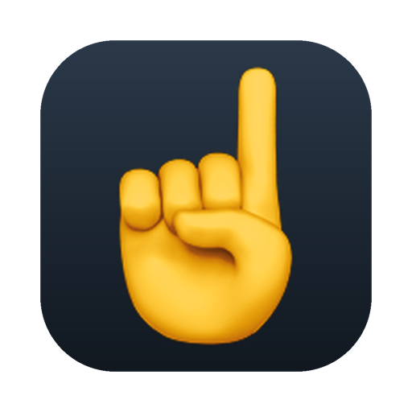
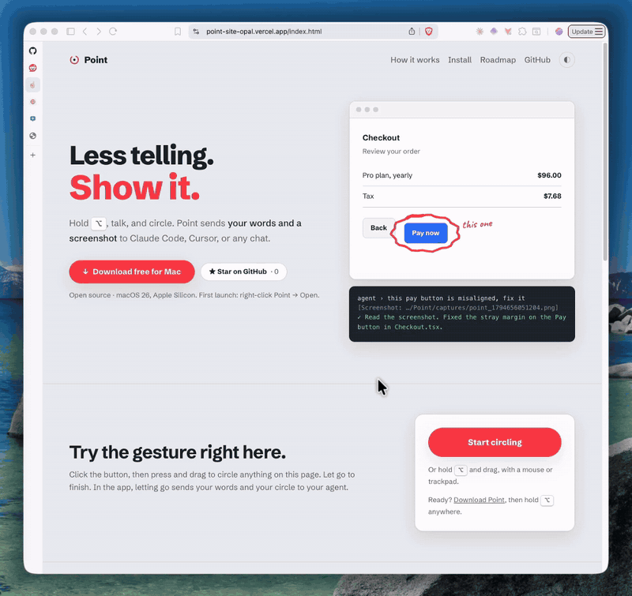

#  Point




## Talk less. Point more.

Hold a key, talk, and circle the thing on your screen. Point hands Claude Code, Cursor, ChatGPT, or any chat your words plus a screenshot of exactly what you pointed at. Without drawing, it's fast on-device dictation.

**[pointandtell.app](https://www.pointandtell.app)** · **[⬇ Download Point.dmg](https://github.com/sksareen/point/releases/latest/download/Point.dmg)** · macOS 26, Apple Silicon · free and open source · voice never leaves your Mac

## What you do, what your agent gets

| You do | Your agent gets |
|---|---|
| **Hold Left ⌃ (Control) and talk** | Your words, pasted at the text cursor of whatever app you're in. Plain dictation. |
| **…and circle something while holding**, in a terminal or code editor (Claude Code, Cursor, VS Code, Ghostty, iTerm, Warp, Zed) | Your words plus `[Screenshot: /path/to/point_….png]`, a full-screen screenshot with your circle drawn on it. The agent reads the file from disk. |
| **…and circle something**, in a chat app or browser (claude.ai, ChatGPT, the Claude app, Slack, Messages) | Your words, then the screenshot itself as an image. It stays on your clipboard to paste again. |
| **…and drag a box** instead (Settings → Mark → Rectangle) | The same, with a red rectangle instead of a loop. |
| **Circle several things** in one hold | One screenshot with every mark on it. |
| **Tap Space while holding**, then let go | Hands-free: Point keeps listening while you use your Mac. Press the key again to paste, or Esc to cancel. |
| **Double-tap Left ⌃** (or ⌃⇧N) | A sticky pad that floats over everything. Autosaved, 1,440 characters. Hold the key while it's open to dictate into it. |

## Why not just paste a screenshot?

You can, and you should mark it. A screenshot with no mark tells the agent what you're looking at, not what you mean: on a busy page that's dozens of candidates, and the agent picks one confidently. The fix is to circle the thing and say one sentence about it.

By hand that's six or seven steps: take the screenshot, open it, draw on it, save or copy it, switch back, paste it, type the request. Most people skip the drawing, which is the step that matters. Point does all of it in one gesture, while you talk. More on why this works: [why it's so hard to explain things to your AI agent](https://www.pointandtell.app/blog/why-its-hard-to-explain-things-to-your-ai-agent.html).

## How is this different from…

- **Dictation apps** (Wispr Flow, superwhisper, VoiceInk, macOS Dictation) turn speech into text. Point does that too, and adds the screenshot with your mark, because words carry *what's* wrong well and *where* it is badly.
- **[Point and Yap](https://pointandyap.com)** records your voice and cursor position into a local queue that agents read over MCP. Point pastes straight into the app you're already in, so it also works with tools that don't speak MCP (claude.ai, ChatGPT, Slack) and needs no setup in the agent.
- **[Assist](https://www.producthunt.com/r/HRQNZUNMW6OS3A)** turns your annotations and speech into a prompt with a local model, for you to copy into Codex or Claude Code. It's a one-time purchase. Point keeps your exact words, pastes for you, and is free and open source.

Prefer another key? Pick **Left ⌃**, **Right ⌥**, **Right ⌘**, or **Fn** from the menu bar icon → *Trigger key*. Left Control is the default; Right Option never clashes with shortcuts.

The first time you open Point, a short welcome walks you through permissions and one practice run. It's in the menu bar icon → *Welcome to Point…* any time.

Prefer boxes to loops? *Settings → Mark → Rectangle* lets you drag a red box instead of drawing a circle.

Transcription runs **on-device** with Apple's `SpeechAnalyzer` (macOS 26). No audio leaves your Mac.

[Watch the full video](site/point-demo.mp4).

[](https://justbuildapps.com/u/savar/point)

## Install

Requires **macOS 26 on Apple Silicon**.

### Let your agent install it (recommended)

Paste this into Claude Code, Cursor, Codex, or any agent that can run commands:

> Install Point: read https://raw.githubusercontent.com/sksareen/point/master/INSTALL.md and follow it.

[INSTALL.md](INSTALL.md) is written for agents. It checks your Mac, installs or updates Point, adds the Claude Code plugin if you're in Claude Code, and ends with one short report: what was installed, the three permissions macOS will ask for, and how to use it.

### Or install it yourself

**Download:** [Point.dmg](https://github.com/sksareen/point/releases/latest/download/Point.dmg), open it, and drag Point to Applications. Point isn't notarized by Apple yet, so the first launch is blocked: open **System Settings → Privacy & Security** and click **Open Anyway**.

**Or paste this into Terminal**, which skips that block:

```sh
curl -fsSL https://raw.githubusercontent.com/sksareen/point/master/get.sh | bash
```

It downloads the latest release into Applications and opens it ([read the script](get.sh)). Then grant **Accessibility** and **Microphone** when asked, and **Screen Recording** the first time you draw a loop.

A notarized download and a Homebrew cask are coming.

## Claude Code plugin

Point works in Claude Code with nothing extra: it pastes your words and the screenshot's path. The plugin adds two things on top.

```
/plugin install point --marketplace sksareen/point
```

- **Claude reads captures properly.** It opens the screenshot first, treats your red loop or rectangle as "this", and allows for dictation mishearings.
- **`/point:last`** pulls in your most recent capture without pasting. Circle something in any app, switch to Claude Code, and type `/point:last fix this`. `/point:last 3` reads the last three.

On Claude Code older than 2.1.275, run `/plugin marketplace add sksareen/point` and then `/plugin install point@point-mac`.

## Build from source

Requires macOS 26 and Xcode command-line tools.

```sh
git clone https://github.com/sksareen/point && cd point
./make-signing-cert.sh   # once: stable signing so macOS remembers permissions
./install.sh             # builds, installs to /Applications, launches
```

On first run, grant **Accessibility** (to see the key), **Microphone**, and, the first time you draw a loop, **Screen Recording**. Turn on **Launch at login** from the menu bar icon.

**Why the signing cert?** macOS ties privacy permissions to an app's code signature. Ad-hoc signatures change on every build, so macOS silently forgets Point's permissions after each rebuild. A self-signed certificate keeps the identity stable. If `codesign` keeps asking for your keychain password, run the `security set-key-partition-list` command that `make-signing-cert.sh` prints.

## The Point window

Menu bar icon → **Open Point…** shows every capture as a time machine: newest first, grouped by day, searchable, with ↑/↓ to move through time. Each capture shows the screenshot (click for full size), the transcript, and the recording you can play back. **Settings…** has the trigger key, launch at login, permission status with one-click fixes, and the vocabulary list.

## Your data

Everything lives in `~/Library/Application Support/Point/`:

- `captures/point_<id>.png`: screenshots (only when you drew a loop)
- `captures/point_<id>.wav`: exactly what the speech model heard (16 kHz mono)
- `captures/point_<id>.json`: transcript, timings per stage, and an empty `reference` field. Fill in what you actually said to score accuracy.
- `sticky.txt`: the sticky pad
- `vocab.txt`: words to bias transcription toward (names, jargon), one per line. Edit it in *Settings → Vocabulary*.

## Layout

```
Sources/
  main.swift          app entry, menu bar, Accessibility, ⌃⇧N
  TriggerKey.swift    which modifier key drives Point (menu setting)
  Gesture.swift       trigger hold/double-tap, overlay, screenshot, paste
  Transcriber.swift   Transcriber protocol + Apple on-device implementation
  Sticky.swift        the sticky pad
  Onboarding.swift    first-launch welcome: permissions and a practice run
  Window.swift        the Point window: captures time machine + Settings (SwiftUI)
  LoginItem.swift     launch at login, version, menu items
  SauronHook.swift    optional: logs screenshots to Sauron if it's installed
```

`plugin/` is the Claude Code plugin (two skills); `.claude-plugin/marketplace.json` lists it.

The speech engine sits behind the `Transcriber` protocol, so swapping in whisper.cpp or Parakeet is one new file.

## Roadmap

Next: a notarized download and Homebrew, a faster start, voice commands ("search Porter Robinson on YouTube"), and recording a bug repro with zoom on clicks. Later: older Macs via Whisper or Parakeet, and agents that ask you to point.

Far out, a wand: aim at any screen, click to select, hold to draw, and talk while you point.


Ideas welcome in [issues](https://github.com/sksareen/point/issues).

## Status

Early preview (0.1.3). Known: about 200–270 ms from key-down until the mic is live, so your first syllable can be clipped if you start talking instantly.
