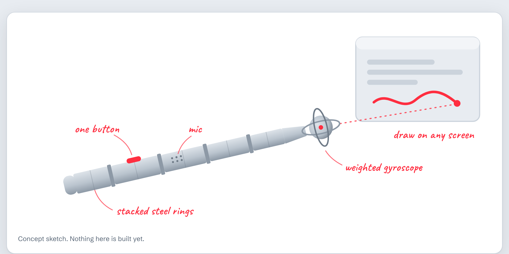

# Point


**Show your AI agent what you mean.** Hold a key, talk, and circle the thing on your screen. Point hands Claude Code, Cursor, or any chat your words plus a screenshot of exactly what you pointed at. Without drawing, it's just fast on-device dictation.

| Gesture | What happens |
|---|---|
| **Hold Right ⌥ and talk** | Dictation. Your words are pasted at the text cursor and left on the clipboard. |
| **…and draw a loop while holding** | Your words, plus the path to a full-screen screenshot with your loop drawn on it. Paste into Claude Code, Cursor, or any agent that reads files. |
| **Double-tap Right ⌥** (or ⌃⇧N) | Toggle a sticky pad that floats over everything. Autosaved, persistent, 1,440 characters. Hold Right ⌥ while it's open to dictate into it. |

Prefer another key? Pick **Right ⌥**, **Left ⌃**, **Right ⌘**, or **Fn** from the menu bar icon → *Trigger key*.

Transcription runs **on-device** with Apple's `SpeechAnalyzer` (macOS 26). No audio leaves your Mac.

[Watch the full video](site/point-demo.mp4).

[](https://justbuildapps.com/u/savar/point)

## Install

Requires **macOS 26 on Apple Silicon**. Paste this into Terminal:

```sh
curl -fsSL https://raw.githubusercontent.com/sksareen/point/master/get.sh | bash
```

It downloads the latest release into Applications and opens it ([read the script](get.sh)). Then grant **Accessibility** and **Microphone** when asked, and **Screen Recording** the first time you draw a loop.

A notarized download and a Homebrew cask are coming.

## Build from source

Requires macOS 26 and Xcode command-line tools.

```sh
git clone https://github.com/sksareen/point && cd point
./make-signing-cert.sh   # once: stable signing so macOS remembers permissions
./install.sh             # builds, installs to /Applications, launches
```

On first run, grant **Accessibility** (to see the key), **Microphone**, and, the first time you draw a loop, **Screen Recording**. Turn on **Launch at login** from the menu bar icon.

**Why the signing cert?** macOS ties privacy permissions to an app's code signature. Ad-hoc signatures change on every build, so macOS silently forgets Point's permissions after each rebuild. A self-signed certificate keeps the identity stable. If `codesign` keeps asking for your keychain password, run the `security set-key-partition-list` command that `make-signing-cert.sh` prints.

## The Point window

Menu bar icon → **Open Point…** shows every capture as a time machine: newest first, grouped by day, searchable, with ↑/↓ to move through time. Each capture shows the screenshot (click for full size), the transcript, and the recording you can play back. **Settings…** has the trigger key, launch at login, permission status with one-click fixes, and the vocabulary list.

## Your data

Everything lives in `~/Library/Application Support/Point/`:

- `captures/point_<id>.png`: screenshots (only when you drew a loop)
- `captures/point_<id>.wav`: exactly what the speech model heard (16 kHz mono)
- `captures/point_<id>.json`: transcript, timings per stage, and an empty `reference` field. Fill in what you actually said to score accuracy.
- `sticky.txt`: the sticky pad
- `vocab.txt`: words to bias transcription toward (names, jargon), one per line. Edit it in *Settings → Vocabulary*.

## Layout

```
Sources/
  main.swift          app entry, menu bar, Accessibility, ⌃⇧N
  TriggerKey.swift    which modifier key drives Point (menu setting)
  Gesture.swift       trigger hold/double-tap, overlay, screenshot, paste
  Transcriber.swift   Transcriber protocol + Apple on-device implementation
  Sticky.swift        the sticky pad
  Window.swift        the Point window: captures time machine + Settings (SwiftUI)
  LoginItem.swift     launch at login, version, menu items
  SauronHook.swift    optional: logs screenshots to Sauron if it's installed
```

The speech engine sits behind the `Transcriber` protocol, so swapping in whisper.cpp or Parakeet is one new file.

## Roadmap

Next: the screenshot itself on the clipboard for web chats, a notarized download and Homebrew, a faster start, voice commands ("search Porter Robinson on YouTube"), and recording a bug repro with zoom on clicks. Later: older Macs via Whisper or Parakeet, and agents that ask you to point.

Far out, a wand: aim at any screen, click to select, hold to draw, and talk while you point.



Ideas welcome in [issues](https://github.com/sksareen/point/issues).

## Status

Early dev build (0.1.0). Known: about 200–270 ms from key-down until the mic is live, so your first syllable can be clipped if you start talking instantly.
